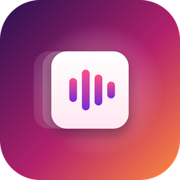
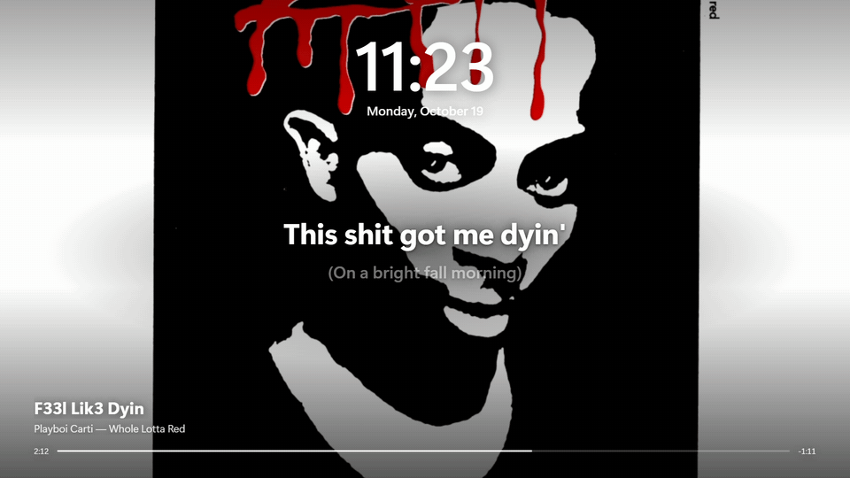
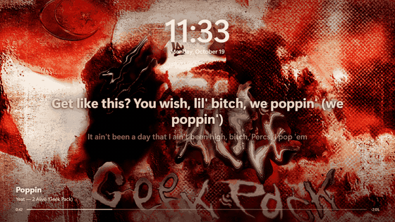
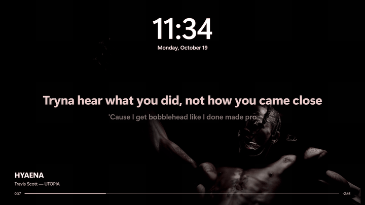
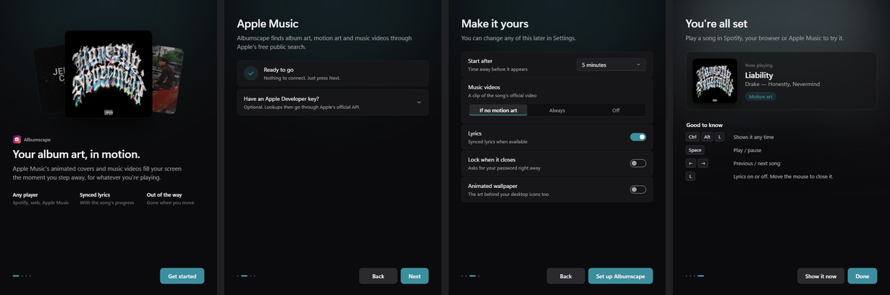
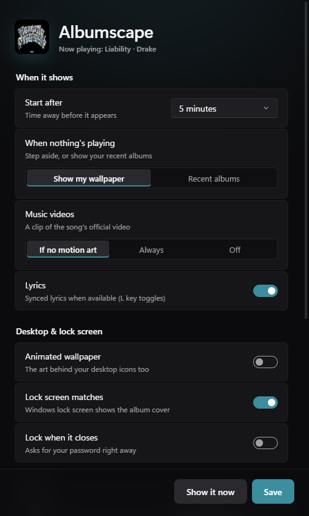

<h1 align="center">Albumscape</h1>

<b>Your album art, moving, the moment you step away.</b>

<a href="https://github.com/aosmannn/albumscape-releases/releases/latest/download/AlbumscapeSetup.exe"><b>Download for Windows</b></a> · <a href="https://aosmannn.github.io/albumscape-releases/">Website</a>

Albumscape turns your Windows PC into a living album cover. Walk away for a minute, or press Ctrl+Alt+L, and the
animated artwork of whatever you're playing fills the screen, with the time, the song and its lyrics on top.

## What it does

- **Real motion art.** Albums with animated covers on Apple Music play them full screen.
- **Follows your music.** Spotify, your browser or Apple Music. It switches the moment the song changes.
- **Music videos too.** No motion art? The song's official music video plays instead, in step with the song
  (full videos for chart songs, a clip for the rest), or the sharp cover.
- **Lyrics that follow along,** a progress bar, and the album's own colors.
- **Your lock screen matches,** and an optional animated wallpaper behind your desktop icons.
- **Good at night.** It dims, then turns your monitor off.
- **Free, no account, no keys.** Nothing is uploaded; it runs entirely on your PC.

| | |
| --- | --- |
|  |  |

## Install

1. Download **[AlbumscapeSetup.exe](https://github.com/aosmannn/albumscape-releases/releases/latest/download/AlbumscapeSetup.exe)** (Windows 10 or 11).
2. Run it. Windows may say it's from an unknown publisher: click **More info > Run anyway**.
3. A short setup guide walks you through a few choices. Then play a song and press **Ctrl+Alt+L**.

Installed copies update themselves.

| Key | What it does |
| --- | --- |
| **Ctrl+Alt+L** | Show it now |
| **Space** | Play / pause |
| **← / →** | Previous / next song |
| **L** | Lyrics on / off |
| Mouse or any other key | Close it |

Change anything from **Start menu > Albumscape Settings**. Remove it from **Windows Settings > Apps**; your previous
screensaver and lock screen picture are put back.

Have an Apple Developer MusicKit key? You can add it in the setup guide (optional).

---

Made by [Adam Osman (@aosmannn)](https://github.com/aosmannn). This repository hosts the installer and
`videos.json`, the list of official YouTube music videos for chart songs (video IDs only), updated daily by
`tools/update_videos.py`.
Motion artwork and covers come from Apple Music; synced lyrics from [LRCLIB](https://lrclib.net). Motion art is
read from Apple Music's public web pages, which Apple can change at any time. Not affiliated with Apple.
