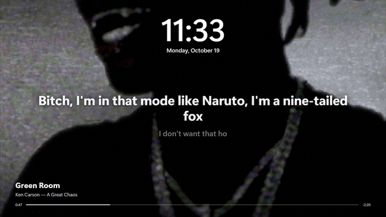
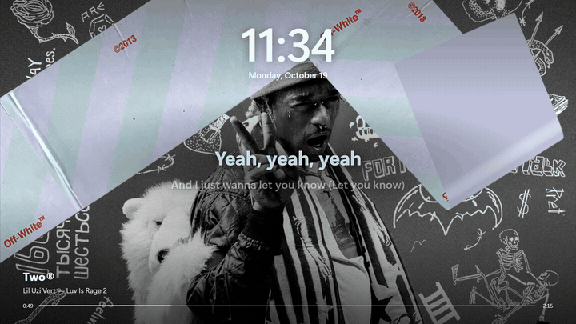
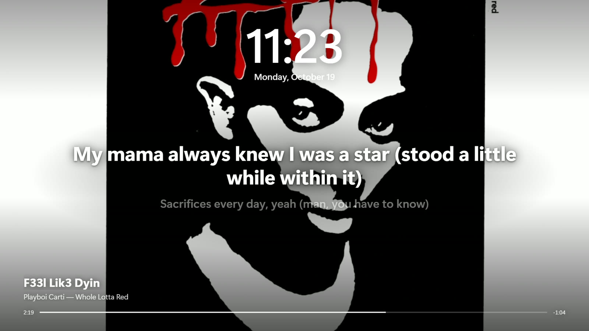
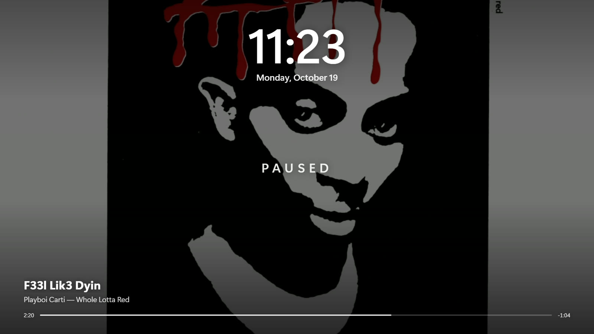
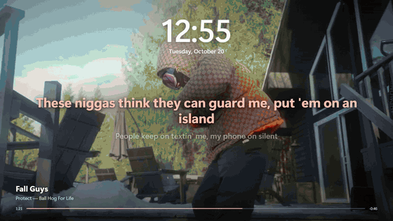
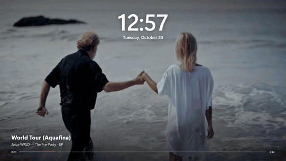
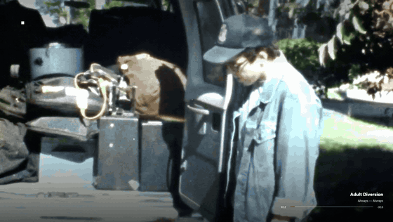
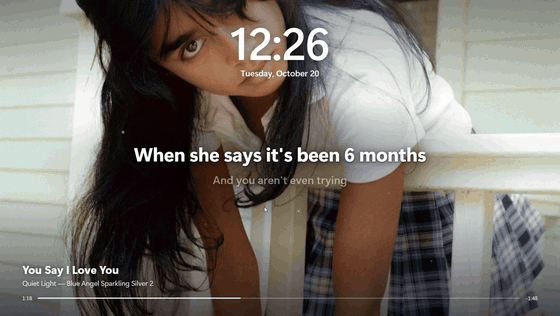

<h1 align="center">Albumscape</h1>

<b>Your music, full screen.</b> 
When you step away, whatever you're playing fills your screen: animated album art, the music video, lyrics, the time.

  <a href="https://github.com/aosmannn/albumscape-releases/releases/latest/download/AlbumscapeSetup.exe"><b>⬇ &nbsp;Download for Windows</b></a>
  &nbsp;·&nbsp;
  <a href="https://albumscape.vercel.app/">Website</a>

Free · Windows 10 and 11 · no account, no keys · works with Spotify, Apple Music and your browser

---

## Get started in 3 steps

**1. Download it.** Click **[Download for Windows](https://github.com/aosmannn/albumscape-releases/releases/latest/download/AlbumscapeSetup.exe)** (a 16 MB file called `AlbumscapeSetup.exe`).

**2. Run it.** Open the file you just downloaded. Windows may say *"Windows protected your PC"* because Albumscape is new and not code-signed yet. That's expected: click **More info**, then **Run anyway**. Installing takes a few seconds and needs no admin rights.

**3. Follow the 4-step guide.** It opens by itself. Pick how long you want to be away before it appears (5 minutes is a good start), then press **Set up Albumscape**.

That's it. **Play a song** in Spotify, Apple Music or a browser, then press **Ctrl + Alt + L** to see it now, or just step away and it appears on its own. Move the mouse and it goes away.

---

## What it does

- **Animated album art.** Albums that have moving covers on Apple Music play them full screen.
- **Music videos.** The song's official music video (or official visualizer) plays in full, in step with the song, before the album's motion art. Skip ahead and it crossfades to the new spot. No video? You get the motion art or the sharp album cover.
- **Lyrics** that follow the song, a progress bar, and the album's own colors.
- **Everything follows your music.** Skip a track and the screen changes with it. If a YouTube tab is open too, the song you're actually playing wins.
- **Nothing playing?** Your albums' moving covers play one after another (or your recent albums fill the screen), with **music news** from your artists: new singles and albums, countdowns to albums that aren't out yet, and new official videos.
- **Coming soon.** Play a single from an album that isn't out yet and the screen says when the album drops.
- **Last.fm (optional).** Type your username in Settings and the shuffle and news follow your real listening. No login, no key.
- **Optional extras:** the same art behind your desktop icons, a lock screen that matches the album, and a bedtime when your PC goes to sleep.

## See it

| | |
| --- | --- |
|  |  |
| *Yeat, 2 Alivë (Geëk Pack)* | *Ken Carson, A Great Chaos* |
|  |  |
| *Travis Scott, UTOPIA* | *Lil Uzi Vert, Luv Is Rage 2* |
|  |  |
| *Playing, with lyrics* | *Paused* |

## Watch it with sound

Recorded on a real PC with the song playing. Click a preview to open the clip with sound.

| Screensaver | Screensaver |
| --- | --- |
|  |  |
| *Protect, "Fall Guys": music video with synced lyrics* | *Juice WRLD, "World Tour (Aquafina)": music video* |
| **Desktop wallpaper** | **Screensaver** |
|  |  |
| *Alvvays, "Adult Diversion": the music video behind the desktop icons* | *Quiet Light, "You Say I Love You": cover with lyrics* |

## Keys while it's showing

| Key | What it does |
| --- | --- |
| **Ctrl + Alt + L** | Show it right now |
| **Space** | Play / pause |
| **← / →** | Previous / next song |
| **L** | Lyrics on / off |
| **I** | Song info on / off (just the art and the clock) |
| **Ctrl + Alt + X** | Wrong video? Never show it again |
| Mouse or any other key | Close it |

## Change anything later

Open **Start menu → Albumscape Settings**. Everything is a switch or a dropdown, and **Show it now** previews your choices.

---

## Something not working?

| What you see | What to try |
| --- | --- |
| Windows says it's from an unknown publisher | Click **More info → Run anyway**. It's safe; the app just isn't code-signed yet. |
| Nothing shows when I press Ctrl + Alt + L | Check that a song is playing on **this PC** (Spotify, Apple Music or a browser). Music playing on your phone isn't visible to Windows. |
| It shows the cover but no video | Not every song has a music video. Songs that do may take a few seconds to appear the first time. |
| The desktop wallpaper isn't moving | Close other wallpaper apps (like Wallpaper Engine), then turn **Animated wallpaper** on in Settings. |
| It put my PC to sleep | That's the bedtime in Settings: it waits until you've stopped using the PC and nothing is playing. Turn off or change **Put the PC to sleep at**. |
| The wrong video plays | Press **Ctrl + Alt + X**. That video is never shown for that song again. |

**Updates** install themselves in the background. **To remove it:** Windows Settings → Apps → Installed apps → Albumscape → Uninstall. Your previous screensaver and lock screen picture come back.

## Privacy

Everything runs on your PC. Nothing about you is uploaded, and there's no account. Album art, lyrics and video lookups work the way a web browser's would.

---

Made by <a href="https://github.com/aosmannn">Adam Osman</a>. Album art comes from Apple Music, lyrics from <a href="https://lrclib.net">LRCLIB</a>, videos from YouTube. Not affiliated with Apple, Spotify or YouTube. This page hosts the installer and <code>videos.json</code>, the list of official videos the app can look up.
